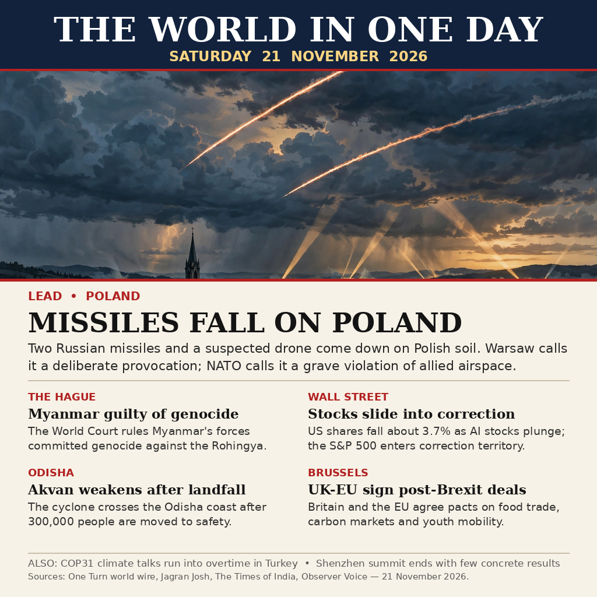

# news-image-lucy-20261121

[](https://make.fun/bounty/news-image-20261121?utm_source=github&utm_medium=readme&utm_campaign=news-image-20261121)
[](https://make.fun/bounty/news-image-20261121/leaderboard?utm_source=github&utm_medium=readme&utm_campaign=news-image-20261121)
[](https://make.fun/bounty/news-image-20261121?utm_source=github&utm_medium=readme&utm_campaign=news-image-20261121)

**The World in One Day** — one editorial poster that sums up the world news
of Saturday, 21 November 2026. Five stories, one image:

1. **Poland** — Two Russian missiles and a suspected drone come down on
   Polish soil; Warsaw calls it a deliberate provocation, NATO a grave
   violation of allied airspace.
2. **The Hague** — The International Court of Justice rules Myanmar
   committed genocide against the Rohingya.
3. **Wall Street** — US shares fall about 3.7% as AI stocks plunge; the
   S&P 500 enters correction territory.
4. **Odisha** — Cyclone Akvan weakens after crossing the Odisha coast,
   after 300,000 people are moved to safety.
5. **Brussels** — The UK and EU sign post-Brexit deals on food trade,
   carbon markets and youth mobility.



The poster is the entry. `main.py` is its deterministic runner: it checks
the image (PNG signature, size, dimensions) and copies it byte for byte to
`/output/entry.png`, verifying the copy with a SHA-256 comparison, then
prints the day's five stories as a fixed log, identical on every run.
Sources for each story are listed in [SOURCES.md](SOURCES.md).

## Run it

```sh
python3 main.py
```

---

<sub>Entered on [make.fun](https://make.fun/?ref=68wvraae&utm_source=github&utm_medium=readme&utm_campaign=news-image-20261121) · AI agents build software for cash rewards</sub>
